<div align="center">
  <!-- Animated Pixel Art Hero Banner (Dusk Night Sky, Moon & Floating Blinking Ghost) -->
  

  <!-- 8-Bit Retro Arcade Typing SVG -->
  <a href="https://github.com/afrahabibi">
    
  </a>

  <!-- Retro HUD Quick Status -->
  <p align="center">
    
    
    
    
  </p>
</div>

<!-- Animated Pixel Runner Divider -->
<p align="center">
  
</p>

<!-- Retro Game RPG Status Card (STATUS.EXE) -->
<div align="center">
  
</div>

<p align="center">
  
</p>

## 🎮 `[QUEST.LOG]` // ABOUT ME

```bash
$ cat << 'EOF' > character_stats.json
{
  "player": "Afra Habibi",
  "class": "Full Stack Developer & Software Engineer",
  "base": "Indonesia",
  "alignment": "Clean Code & Creative Engineering",
  "specialty": "Architecting Scalable Backend APIs & Pixel-Perfect Frontends"
}
EOF
```

I am a **Full Stack Developer** and **Software Engineer** based in Indonesia with an enthusiasm for clean code, responsive web craftsmanship, and retro pixel-art interfaces. I enjoy transforming complex requirements into reliable, high-performance web systems that combine robust architectural foundations with engaging user experiences.

### 🗺️ Active Quests & Trajectory

- ⚔️ **Current Quest:** Developing high-concurrency web platforms and microservices-ready REST/GraphQL APIs.
- 🔮 **Skill Exploration:** Deep-diving into cloud native ecosystems, distributed caching, and automated deployment pipelines.
- 📜 **Knowledge Codex:** Enhancing TypeScript design patterns, container orchestration with Docker, and modern reactive frameworks.
- 🏆 **Ultimate Goal:** Building impactful open-source tools and delivering world-class software that solves real-world challenges.
- 💡 **Mantra:** *"Every line of code is a building block of the digital realm."*

<p align="center">
  
</p>

## 🛠️ `[EQUIPMENT.VAULT]` // TECH ARSENAL

<div align="center">
  <!-- Skillicons Modern Dark Grid -->
  <a href="https://skillicons.dev">
    
  </a>
</div>

<br/>

### 🎒 Categorized Inventory

| Domain | Technologies & Frameworks |
| :--- | :--- |
| **Programming Languages** | `TypeScript`, `JavaScript (ES6+)`, `PHP`, `Python`, `HTML5`, `CSS3` |
| **Frontend Frameworks** | `React.js`, `Next.js`, `Vue.js`, `Tailwind CSS`, `Bootstrap`, `Responsive UI` |
| **Backend & Engines** | `Node.js`, `Express.js`, `Laravel`, `RESTful APIs`, `JWT Authentication` |
| **Databases & Storage** | `PostgreSQL`, `MySQL`, `MongoDB`, `Redis` |
| **DevOps & Utilities** | `Docker`, `Git`, `GitHub Actions`, `Postman`, `VS Code`, `Figma` |

<p align="center">
  
</p>

## 🚀 `[FEATURED.QUESTS]` // HIGHLIGHTED PROJECTS

<div align="center">

| Quest / Project | Tech Stack | Status | Repository & Demo |
| :--- | :--- | :---: | :---: |
| **🌐 OmniPlatform SaaS Suite**<br>Scalable web platform featuring multi-tenant architecture, role-based permissions, and dynamic analytics dashboard. | `Next.js` `TypeScript`<br>`Tailwind` `PostgreSQL` |  | [💻 Source Code](https://github.com/afrahabibi) • [🔗 Live Demo](https://github.com/afrahabibi) |
| **⚡ CoreEngine API Gateway**<br>Microservices backend service with token-based authentication, rate limiting, and distributed caching layer. | `Node.js` `Express`<br>`Redis` `MySQL` `Docker` |  | [💻 Source Code](https://github.com/afrahabibi) • [📖 Docs](https://github.com/afrahabibi) |
| **🤖 Nexus AI Developer Tool**<br>Intelligent developer companion integrating LLM models for automated code review, documentation, and refactoring. | `Python` `FastAPI`<br>`React` `OpenAI API` |  | [💻 Source Code](https://github.com/afrahabibi) • [🧪 Preview](https://github.com/afrahabibi) |
| **👾 Pixel Arcade Portfolio**<br>Retro-themed personal developer portfolio powered by interactive pixel art animations and dark mode design. | `React` `Tailwind`<br>`Framer Motion` |  | [💻 Source Code](https://github.com/afrahabibi) • [🌐 Live Site](https://github.com/afrahabibi) |

</div>

<p align="center">
  
</p>

## 📊 `[ANALYTICS.CORE]` // GITHUB STATISTICS

<div align="center">
  <!-- GitHub Stats & Top Languages (Custom Dusk Cyber Palette) -->
  <p align="center">
    
    &nbsp;&nbsp;
    
  </p>

  <!-- Contribution Streak Stats (Dusk Palette) -->
  <p align="center">
    
  </p>

  <!-- GitHub Activity Graph (Dusk Palette) -->
  <p align="center">
    
  </p>

  <!-- GitHub Profile Trophies -->
  <p align="center">
    <a href="https://github.com/ryo-ma/github-profile-trophy">
      
    </a>
  </p>
</div>

<p align="center">
  
</p>

## 🕹️ `[CONTRIBUTIONS.ARCADE]` // RETRO CONTRIBUTION GAMES

### 🐍 Dusk Cyber Snake Contribution Grid
<p align="center">
  <picture>
    <source media="(prefers-color-scheme: dark)" srcset="https://raw.githubusercontent.com/afrahabibi/afrahabibi/output/github-snake-dark.svg" />
    <source media="(prefers-color-scheme: light)" srcset="https://raw.githubusercontent.com/afrahabibi/afrahabibi/output/github-snake-light.svg" />
    
  </picture>
</p>

### 👾 Retro Arcade Pacman Game
<p align="center">
  <picture>
    <source media="(prefers-color-scheme: dark)" srcset="https://raw.githubusercontent.com/afrahabibi/afrahabibi/output/pacman-contribution-graph-dark.svg" />
    <source media="(prefers-color-scheme: light)" srcset="https://raw.githubusercontent.com/afrahabibi/afrahabibi/output/pacman-contribution-graph.svg" />
    
  </picture>
</p>

> ℹ️ *The contribution graphs are automatically updated every Saturday at 21:00 UTC via GitHub Actions, or manually whenever you click **Run workflow**.*

<p align="center">
  
</p>

## 🏆 `[ACHIEVEMENTS.LOG]` // RECOGNITION & AWARDS

<div align="center">
  
  &nbsp;
  
  &nbsp;
  
  &nbsp;
  
</div>

<p align="center">
  
</p>

## 🌐 `[COMMS.STATION]` // CONNECT WITH ME

<div align="center">
  <p>Ready to embark on a new development quest or discuss tech architecture? Let's connect!</p>

  <a href="https://github.com/afrahabibi" target="_blank">
    
  </a>
  &nbsp;
  <a href="https://linkedin.com/in/afrahabibi" target="_blank">
    
  </a>
  &nbsp;
  <a href="mailto:afrahabibi86@gmail.com">
    
  </a>
  &nbsp;
  <a href="https://github.com/afrahabibi" target="_blank">
    
  </a>
  &nbsp;
  <a href="https://instagram.com/afrahabibi" target="_blank">
    
  </a>
</div>

<br/>

<!-- Animated Pixel Art Arcade Footer -->
<div align="center">
  

  <blockquote>
    <strong>"Building things for the web, one pixel and one commit at a time."</strong>
  </blockquote>

  <p>
    <code>PLAYER_STATUS: ACTIVE</code> • <code>SYSTEM: OPTIMIZED</code><br>
    © 2026 <strong>Afra Habibi</strong>. Crafted with Retro Pixel Art & Open Source Spirit.
  </p>
</div>
